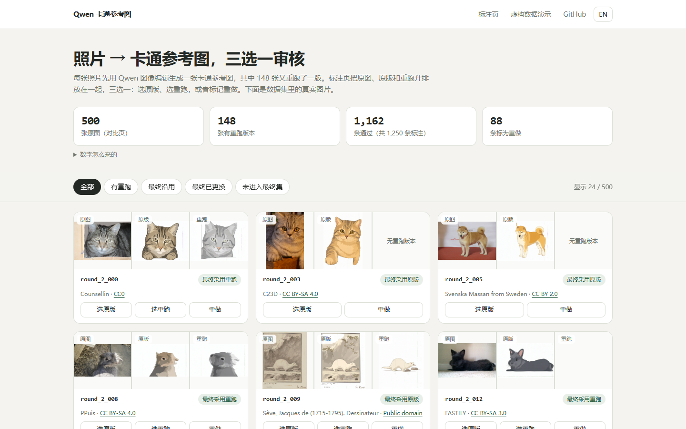
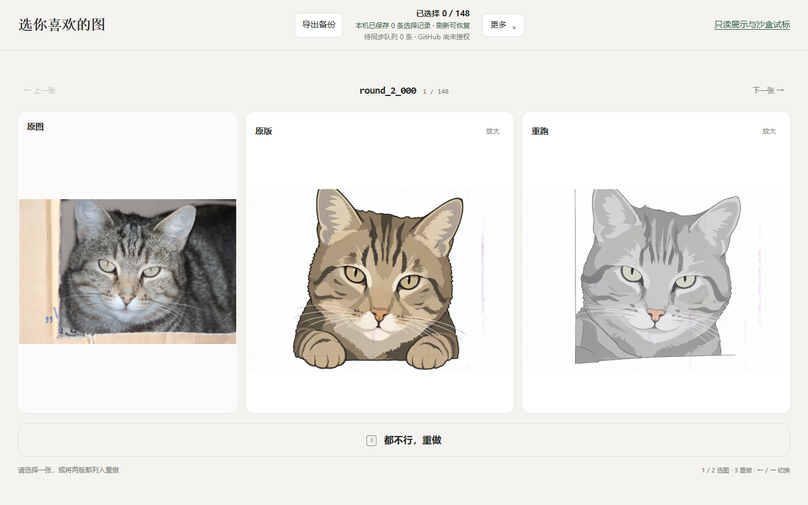

<h1 align="center">Qwen Teacher Review</h1>

<p align="center">
  A static, keyboard-first review page for choosing between cartoon references generated by Qwen image editing: photo, original and rerun side by side, pick one or send it back for redo.
</p>

<p align="center">
  <a href="https://teddytututu.github.io/qwen-teacher-review/showcase.html"><b>Live showcase</b></a> ·
  <a href="https://teddytututu.github.io/qwen-teacher-review/demo.html">Synthetic demo</a> ·
  <a href="#quick-start">Quick start</a> ·
  <a href="docs/development.md">Developer notes</a> ·
  <a href="README.zh-CN.md">简体中文</a>
</p>

<p align="center">
  
  
  
</p>

<p align="center">
  
</p>

## What it is

These cartoon references are the "teacher" images for [AI Bead Pattern](https://github.com/Teddytututu/ai-bead-pattern): each photo was turned into a cartoon with Qwen image editing, and 148 of the 500 photos got a second run. This repository holds the images and the page used to compare and choose between them.

| | |
| --- | --- |
| 500 | source photos on the comparison page |
| 148 | with a rerun version |
| 1,250 | annotation records: 1,162 accepted, 88 redo |

Of the accepted records, 1,156 are labelled as Codex reviews and 6 as manual choices; these are the labels stored in the records. The 500 comparisons and the 1,250 records are different sets. Details are in the [developer notes](docs/development.md).

## Features

- **Three-way choice with the keyboard**: `1` / `2` pick the original or the rerun, `3` sends it back for redo, `←` / `→` move between images; choosing advances automatically.
- **Saved as you go**: every choice is written to the browser first; export JSON or CSV at any time, and import a backup with a full validation pass before anything is replaced.
- **Optional GitHub sync**: with a fine-grained token kept only in the current tab session, choices are uploaded in batches and shown as confirmed only after they are read back.
- **Read-only showcase**: [`showcase.html`](showcase.html) browses all 500 comparisons with filters and a sandbox pick that never leaves the page; Chinese and English.
- **Image credits**: every source photo carries its author, licence and source page ([ATTRIBUTIONS.json](ATTRIBUTIONS.json)).

<p align="center">
  
</p>

## Quick start

No install or build. Serve the folder with any static server and open it:

```sh
python -m http.server 8000
# review app:  http://127.0.0.1:8000/index.html
# showcase:    http://127.0.0.1:8000/showcase.html
# demo:        http://127.0.0.1:8000/demo.html   (synthetic data, no network)
```

The site is also published from `main` with GitHub Pages.

## Tests

```sh
python verify.py --out /tmp/review-checks --no-browser            # Node and CLI checks
python verify.py --out /tmp/review-checks --browser /path/to/chromium
```

Import and recovery rules, the recovery CLIs and their exit codes, and the image-identity notes are in the [developer notes](docs/development.md).

## Licence

Source photos keep their own licences as listed in [ATTRIBUTIONS.json](ATTRIBUTIONS.json).
