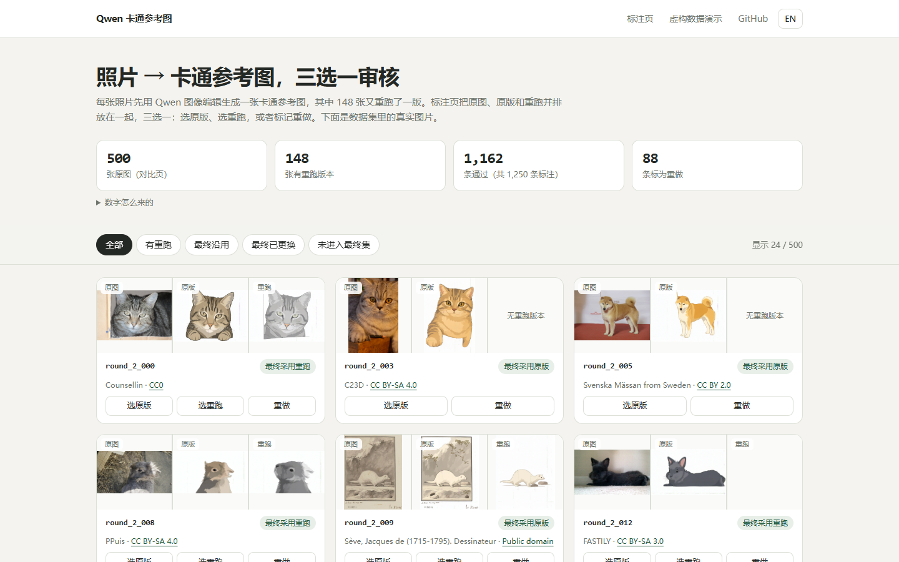
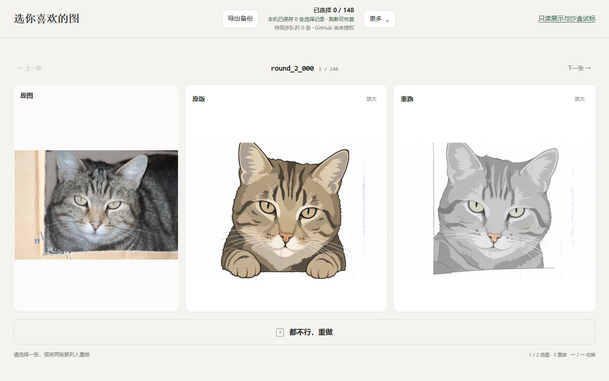

<h1 align="center">Qwen Teacher Review · 卡通参考图三选一</h1>

<p align="center">
  一个纯静态、用键盘就能操作的审核页：原照片、原版卡通图和重跑版并排放，选一张，或者退回重做。卡通图由 Qwen 图像编辑生成。
</p>

<p align="center">
  <a href="https://teddytututu.github.io/qwen-teacher-review/showcase.html"><b>在线展示</b></a> ·
  <a href="https://teddytututu.github.io/qwen-teacher-review/demo.html">虚构数据演示</a> ·
  <a href="#快速开始">快速开始</a> ·
  <a href="docs/development.md">开发说明</a> ·
  <a href="README.md">English</a>
</p>

<p align="center">
  
  
  
</p>

<p align="center">
  
</p>

## 这是什么

这些卡通参考图是 [AI Bead Pattern](https://github.com/Teddytututu/ai-bead-pattern) 的教师图：每张照片先用 Qwen 图像编辑生成一张卡通图，500 张里有 148 张又重跑了一版。这个仓库保存图片和用来比较、挑选的页面。

| | |
| --- | --- |
| 500 | 对比页上的原照片 |
| 148 | 有重跑版本 |
| 1,250 | 条标注记录：1,162 条通过，88 条重做 |

通过的记录里，1,156 条标为 Codex 审核、6 条标为人工选择，这是记录里写的审核来源。500 张对比和 1,250 条记录是两个不同的集合，细节见 [开发说明](docs/development.md)。

## 功能

- **键盘三选一**：`1` / `2` 选原版或重跑，`3` 退回重做，`←` / `→` 切换图片；选完自动跳到下一张。
- **边选边保存**：每次选择先存进当前浏览器，随时导出 JSON 或 CSV；导入备份时先整包检查，通过后才替换。
- **可选同步到 GitHub**：令牌只保存在当前标签页会话里，选择按批次上传，写入后读回核对成功才显示“已确认”。
- **只读展示页**：[`showcase.html`](showcase.html) 可以浏览全部 500 组对比、按状态筛选，卡片上的试选只留在页面内存里；支持中英切换。
- **图片署名**：每张原照片都带作者、许可和出处（[ATTRIBUTIONS.json](ATTRIBUTIONS.json)）。

<p align="center">
  
</p>

## 快速开始

不用安装、不用构建。用任意静态服务器打开这个文件夹：

```sh
python -m http.server 8000
# 审核页：http://127.0.0.1:8000/index.html
# 展示页：http://127.0.0.1:8000/showcase.html
# 演示页：http://127.0.0.1:8000/demo.html（虚构数据，不联网）
```

仓库的 `main` 分支同时通过 GitHub Pages 发布。

## 测试

```sh
python verify.py --out /tmp/review-checks --no-browser            # Node 与命令行检查
python verify.py --out /tmp/review-checks --browser /path/to/chromium
```

导入与恢复规则、恢复命令行工具和退出码、图片身份说明都在 [开发说明](docs/development.md)。

## 许可

原照片沿用各自的许可，见 [ATTRIBUTIONS.json](ATTRIBUTIONS.json)。
